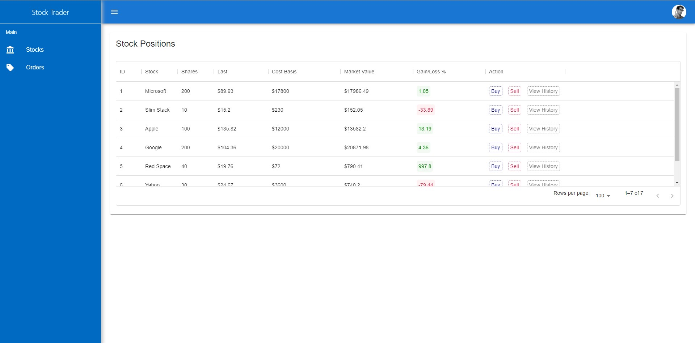

# Stock Trader

## Description

This is a fictitious Stock Trading application.The foundational piece is a web API implemented with .NET 6.0. It leverages Identify Server 4 for security and authentication and is comprised of three client applications: React Client App, Angular Client and Windows Presentation Foundation (WPF) app. For the WPF app, I used Prism library to implement a modular structure and adopt standards such as MVVM and Unity Container.

The React fronend app was implemented with Material UI

## List of projects

### Stock.IdentityServer

* A .NET 6.0 server for authentication using Identity Server 4. Secures the API resources

### Stock.API

* A .NET 6.0 Web API project. Contains all the endpoints for stock information

### Stock.API.Client

* A wrapper around the calls to the Stock.API 

### Stock.API.Tests

* Unit and Integration tests for the Stock.API.

### Stock.Models

* A project that contains all the models related to Stocks

### Stock.WebClient

* A React based web client that authenticates the user using the Stock.IdentityServer and retrieves data from Stock.API using access tokens received from the identity server

### Stock.WebClientAngular

* An Angular based web client that authenticates the user using the Stock.IdentityServer and retrieves data from the Stock.API using access tokens feceived from the identity server

### Stock.MarketUpdater

* A c# console application that mimics periodic updates to the Stock data.

### Stock.WpfClient.Common

* A WPF class library project that contains all the common classes, interfaces and models used in the WPF Client app

### Stock.WpfClient.Authentication

* A WPF class library project implemented as a Prism module. This module is responsible for authentication in the WPF Client app

### Stock.WpfClient.Surveillance

* A WPF class library project implemented as a Prism module. This module is responsible for the charts and stock reports

### Stock.WpfClient.Desktop

* A WPF Application that leverages Prism to load Stock.WpfClient.Surveillance and Stock.WpfClient.Authentication modules

## How to Run

Ensure that you have .NET Framework(min 4.7.2), .NET 6.0 and Node js. Debug the following projects. 
*Test user account : username->'bob' password->'password'
*
* Right-click on the solution file in visual studio. Select 'Properties' and select 'Multiple startup projects'
* and set the following projects to 'Start'
* Stock.IdentityServer
* Stock.API
* Stock.MarketUpdater
* Stock.WebClientAngular or Stock.WebClient or Stock.WpfClient.Desktop.

*Alternatively, you can debug each project from the list above one by one.

