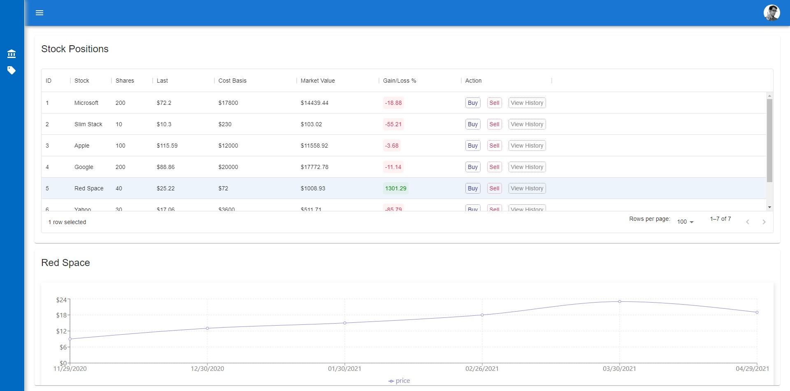

# Stock Trader




## Description

This is a fictitious Stock Trading application. The foundational piece is a web API implemented with .NET 10. It leverages Duende IdentityServer for security and authentication and is comprised of three client applications: a React client app, an Angular client app and a Windows Presentation Foundation (WPF) app. For the WPF app, I used the Prism library to implement a modular structure and adopt standards such as MVVM and Unity Container.

The React frontend app was implemented with Material UI.

## How to Run

### Prerequisites

* [.NET 10 SDK](https://dotnet.microsoft.com/download)
* [Node.js](https://nodejs.org/) 24 LTS, or 22.22 and later (only for the React and Angular clients)
* Windows (the run script and the WPF client are Windows only; the servers and the web clients also run on other platforms with the manual steps below)

No database and no HTTPS certificate are needed. All data is kept in memory and is reset every time the servers restart, and everything runs on plain `http://localhost`.

### Quick start

From the repository root:

```
run.cmd
```

This builds the .NET projects, installs the npm packages on the first run, starts Stock.IdentityServer, Stock.API, Stock.MarketUpdater and the React client, and opens the client in your browser. Press Ctrl+C to stop everything.

Sign in with the test user account: username `bob`, password `password`. You can also create your own account from the login page.

Options (the same options work with `.\run.ps1` from PowerShell):

| Command | What it does |
| --- | --- |
| `run.cmd` | Servers and the React client |
| `run.cmd -Client Angular` | Servers and the Angular client |
| `run.cmd -Client Wpf` | Servers and the WPF client |
| `run.cmd -Client React,Angular,Wpf` | Servers and all three clients |
| `run.cmd -Client None` | Servers only |
| `run.cmd -NoBrowser` | Do not open the browser |
| `run.cmd -NoBuild` | Skip the build (when nothing changed) |

The output of every process is written to the `logs` folder.

### Addresses

| Application | Address |
| --- | --- |
| Stock.IdentityServer | http://localhost:44702 |
| Stock.API | http://localhost:44700 (Swagger UI at http://localhost:44700/swagger) |
| React client | http://localhost:44602 |
| Angular client | http://localhost:44902 |
| WPF client sign-in callback | http://127.0.0.1:44801 |

These addresses are registered with the identity server (`Stock.IdentityServer/Configuration.cs`), so the clients have to run on exactly these ports.

### Running the projects yourself

Each of these runs in its own terminal, from the repository root:

```
dotnet run --project Stock.IdentityServer
dotnet run --project Stock.API
dotnet run --project Stock.MarketUpdater
```

Then start one or more clients:

```
cd Stock.WebClient/ClientApp          (React)
npm install
npm start

cd Stock.WebClientAngular/ClientApp   (Angular)
npm install
npm start

dotnet run --project Stock.WpfClient.Desktop
```

In Visual Studio: right-click the solution, select 'Properties' and 'Multiple startup projects', and set Stock.IdentityServer, Stock.API, Stock.MarketUpdater and one of Stock.WebClient, Stock.WebClientAngular or Stock.WpfClient.Desktop to 'Start'. The two web client projects start their npm dev server for you and open it in the browser.

### Tests

```
dotnet test                                                            (API unit and integration tests)
cd Stock.WebClientAngular/ClientApp && npm test -- --watch=false       (Angular unit tests)
cd Stock.WebClient/ClientApp && npm run lint                           (React lint)
```

## List of projects

### Stock.IdentityServer

* A .NET 10 server for authentication using Duende IdentityServer and ASP.NET Core Identity. Secures the API resources. The web clients sign in with the authorization code flow with PKCE.

### Stock.API

* A .NET 10 Web API project. Contains all the endpoints for stock information

### Stock.API.Client

* A wrapper around the calls to the Stock.API 

### Stock.API.Tests

* Unit and Integration tests for the Stock.API (xUnit v3).

### Stock.Models

* A project that contains all the models related to Stocks

### Stock.WebClient

* A React based web client (React 19, Vite, Material UI) that authenticates the user using the Stock.IdentityServer and retrieves data from Stock.API using access tokens received from the identity server. The React app is in the `ClientApp` folder; the .NET project hosts it.

### Stock.WebClientAngular

* An Angular based web client (Angular 22) that authenticates the user using the Stock.IdentityServer and retrieves data from the Stock.API using access tokens received from the identity server. The Angular app is in the `ClientApp` folder; the .NET project hosts it.

### Stock.MarketUpdater

* A C# console application that mimics periodic updates to the Stock data.

### Stock.WpfClient.Common

* A WPF class library project that contains all the common classes, interfaces and models used in the WPF Client app

### Stock.WpfClient.Authentication

* A WPF class library project implemented as a Prism module. This module is responsible for authentication in the WPF Client app

### Stock.WpfClient.Surveillance

* A WPF class library project implemented as a Prism module. This module is responsible for the charts and stock reports

### Stock.WpfClient.Desktop

* A WPF Application (.NET 10) that leverages Prism to load Stock.WpfClient.Surveillance and Stock.WpfClient.Authentication modules

## Notes

* **Duende IdentityServer license.** Duende IdentityServer replaced IdentityServer4, which is no longer maintained. It is free for development and testing, and free in production under its Community Edition for individuals and small companies; otherwise it needs a paid license (https://duendesoftware.com/products/identityserver). Without a license key it logs a notice at startup, which is expected here.
* **Prism.** The WPF client stays on Prism 8.1.97, the last release under the MIT license. Prism 9 and later use a commercial/community license.
* **Local development only.** The servers use plain http, in-memory data, a developer signing key and a known test user. Do not deploy this configuration as it is.
